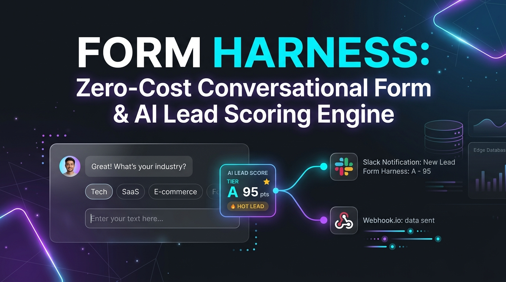

# Form Harness 💬⚡
**Zero-Cost Conversational Form & AI Lead Scoring Engine on Cloudflare Workers + D1 + MCP**



Typeform（月額$29〜$99）や formrun（月額1万円〜）、HubSpot Starter等の高額なフォーム＆リード管理SaaSを、**Cloudflare Workers + D1 の完全無料枠（月額0円）**で置き換えるオープンソースの対話型フォーム＆AIリード自動振り分けエンジンです。

## ✨ 主な特徴
1. **回答数上限なし・月額0円の対話型フォーム**: Typeformのようなレスポンス制限による従量課金ストレスを完全撤廃。
2. **リアルタイムAIリードスコアリング（Tier A / B / C 判定）**: 予算感・導入時期・組織規模・法人ドメイン認証から0〜100点で即時採点。
3. **ホットリードの秒速ルーティング**: Tier A（80点以上）のリードが送信された瞬間にSlack / LINEへ通知し、優先商談カレンダーURL付きの返信文面を自動生成。
4. **AIエージェント（MCP）完全対応**: Claude Code や Cursor から直接リード一覧の抽出、スコア分析、個別フォローメール生成を実行可能。

## 🚀 クイックスタート

```bash
git clone https://github.com/reina20xx/form-harness.git
cd form-harness
npm install

# ローカル開発サーバー起動 (http://localhost:8790)
npm run dev

# E2Eテスト実行
node test-e2e.js
```

## 🤖 MCP (Model Context Protocol) ツール一覧
- `list_leads`: Tier（A/B/C）別のリード一覧とAIスコアの取得
- `score_and_submit_lead`: 新規リードのAIスコアリング＆自動ルーティング実行
- `generate_personalized_followup`: リードの課題・予算に最適化した個別提案メール文面の自動生成
- `get_conversion_funnel_stats`: ファネル転換率およびTier分布の取得

## 📄 ライセンス
MIT License
